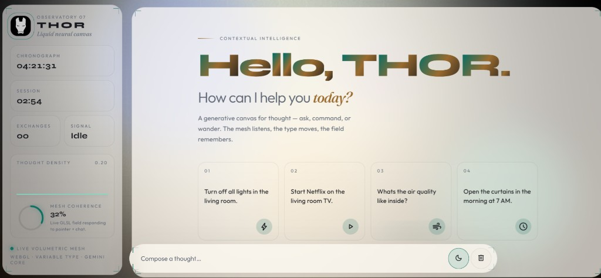

# THOR · Neural Observatory

**Live site:** [https://viswanath-rao.github.io/AI-chatbot/](https://viswanath-rao.github.io/AI-chatbot/)



A Gemini-powered personal chatbot with a custom web interface: liquid WebGL background, live HUD, kinetic type, and a glass chat canvas.

Live chat uses the Google Gemini API from the browser. The UI is HTML, CSS, and JavaScript only — no build step.

## Features

- Conversational chat with Gemini (`generateContent`)
- Suggestion chips to start a prompt in one click
- Light / dark atmosphere toggle (saved in the browser)
- Session HUD: clock, session timer, exchange count, signal, thought-density sparkline, mesh coherence ring
- WebGL / GLSL generative mesh that follows the pointer
- Bounding-box layout, spatial parallax, and kinetic variable-font title
- Chat history stored in `localStorage`

## Tech stack

| Layer | What it uses |
| --- | --- |
| Markup | `index.html` |
| Style | `style.css` (glass panels, motion, responsive layout) |
| Chat + API | `script.js` |
| Visual engine | `visual.js` (WebGL mesh, HUD, pointer parallax) |
| Model | Gemini 3.x via Google AI Studio key |

## Run locally

1. Open `index.html` in a browser, or serve the folder (Live Server / any static server).
2. Put your Gemini API key in `script.js`:

```javascript
const API_KEY = "YOUR_GEMINI_API_KEY";
const API_URL = `https://generativelanguage.googleapis.com/v1beta/models/gemini-3.5-flash-lite:generateContent?key=${API_KEY}`;
```

3. Get a key from [Google AI Studio](https://aistudio.google.com/apikey).
4. If a model is busy or blocked for new users, keep the same key and only change the model id (`gemini-3.5-flash-lite`, `gemini-3.6-flash`, or `gemini-3.8-flash`).

Do not commit a real key if you can avoid it. Anyone who opens `script.js` on a public GitHub Pages site can copy it. Revoke the key in AI Studio if it leaks.

## Project structure

```
AI-chatbot/
├── index.html      # Shell, HUD, composer, chat stage
├── style.css       # Theme, layout, motion
├── script.js       # Gemini requests, messages, theme, wipe
├── visual.js       # Canvas / WebGL + dashboard
├── images/         # Logo, avatars, README preview
└── Readme.md
```

## GitHub Pages

This is a static site. After the repo is **public**:

1. Settings → Pages
2. Deploy from branch → `main` → `/ (root)`
3. Open [https://viswanath-rao.github.io/AI-chatbot/](https://viswanath-rao.github.io/AI-chatbot/)
